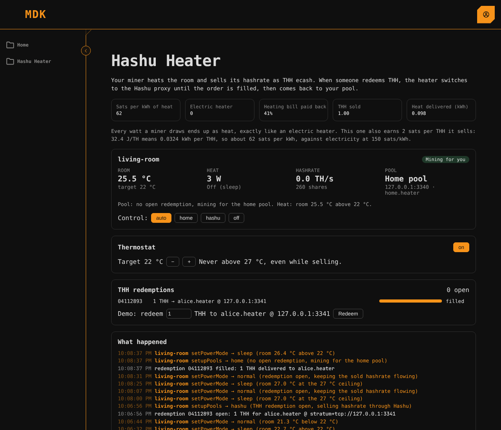

# Hashu on MDK: a heater that sells its hashrate

A home miner is a heater that earns bitcoin. With Hashu it can also **sell**
its hashrate: buyers pay Lightning or Tether for `TiH` (tebihash, 2^40 hashes; Chaumian
hashrate vouchers on Cashu, blind-signed so the mint can't link a purchase to a redemption), and
redeem it by pointing hashrate at their own pool.

This directory is a [Tether MDK](https://github.com/tetherto/mdk) (0.13.1)
stack that does the switching:

```
              MDK Kernel ── pullTelemetry / sendCommand ──▶ heater Worker ──AxeOS HTTP──▶ heater / Bitaxe
                  ▲                                                                       │ Stratum
 Hashu Heater app ┘ ◀── GET /status ── hashu proxy :3333 ◀──── while a redemption is open ┘
   (thermostat,                          │ credits shares,
    sats/kWh)                            └─▶ routes to the redeemer's pool
                                                              otherwise ──▶ home pool
```

1. Someone redeems TiH; the Hashu proxy opens a redemption.
2. The **Hashu Heater app** sees it on the proxy's control API and sends
   `setupPools` through the MDK Kernel: the heater moves from the home pool
   to the Hashu proxy.
3. The proxy routes the heater's shares to the redeemer's pool and credits
   them to the redemption.
4. When it is filled, the app sends `setupPools` back to the home pool.

Meanwhile a thermostat keeps the room at its setpoint (`setPowerMode`), with a
hard ceiling, and the page shows sats earned per kWh of heat against a plain
electric heater.

| Part | Path |
|---|---|
| Stack spec | [`mdk.yaml`](mdk.yaml) |
| Heater Worker (AxeOS: Bitaxe, mock heater) | [`workers/heater`](workers/heater) |
| Hashu Heater app (controller, routes, dashboard page) | [`apps/hashu`](apps/hashu) |
| Proxy control API | [`../hashu-proxy/src/control.rs`](../hashu-proxy/src/control.rs) |

## Run the demo (no hardware)

Needs Node ≥ 24, npm 11, Rust, `protoc`, and the MDK CLI:

```bash
npm i -g @tetherto/mdk-cli@0.13.1
cd mdk && ./scripts/demo.sh
```

Open http://localhost:3030, sign in as `demo@hashu.io` / `hashu-demo-2026`,
and open **Hashu Heater**. Then:

1. Press **Redeem** (3,274 TiH, about 1 TH-hour). The heater switches to the Hashu proxy, its
   shares go to the redeemer pool, and after about 90 s at 40 TH/s it is back on the home pool.
2. Move the target temperature. The heater sleeps above it and heats below it.
3. **Failure case**: `kill $(cat .mdk/demo-logs/proxy.pid)`. The app reports
   Hashu unreachable and sends the heater back to the home pool.

Everything binds to loopback and the stack runs its own DHT bootstrap
(`spec.network.dht`), so venue Wi-Fi that blocks UDP doesn't matter.



## Real hardware

- **Bitaxe**: in `mdk.yaml`, drop `mock: true`, set the device `opts.host`
  to the Bitaxe's IP, and point the app's `homePool` / `redeemPool` at the
  Testnet4 pool (`stratum+tcp://216.230.225.61:3333`, any worker name,
  password `x`). Run the proxy with `--upstream 216.230.225.61:3333`.
- **Heatbit**: no LAN API, so set its pool to the Hashu proxy in the Heatbit
  app; the proxy alone does the switching.

## Safe by default

- Hashu unreachable: the heater falls back to the home pool.
- No room temperature reading: eco, never flat out.
- Room at the ceiling: sleep even mid-redemption; it resumes when the room cools.
- Manual override per heater: auto, home, hashu, off.
- `POST /redemptions` on the proxy is off unless `--control-allow-open`, and binds to loopback.
