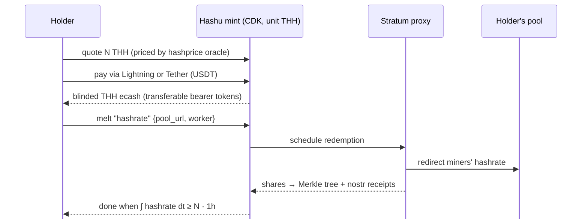

# Hashu

### Bearer ecash for hashrate-time

**The problem**

- Buying hashrate today is custodial, KYC-heavy and locked into rigid contracts
- You can't hold, transfer, or resell it like money
- You can't point it at the pool *you* choose, on demand

**Hashu**

- A Stratum proxy fused with a **Cashu mint (CDK)**
- Mints blinded ecash in **THH**: terahash-hours
- **1 THH = 1 TH/s × 3,600 s ≈ 3.6 × 10¹⁵ hashes**
- Holders redeem by **redirecting real hashrate** to their pool
- Self-hosted: anyone with hashrate can run an instance

hashu.io · Rust · MIT / Apache-2.0

<!--
Hook: hashrate is a commodity, but there's no bearer instrument for it.
Cashu gives privacy-preserving bearer tokens; a Stratum proxy gives programmable
control over where hashrate points. Compose them and you get a voucher for
hashrate-time that the mint can't link to the holder.
-->

---

# How it works

**Mint** · price locks in today's hashprice:
`invoice = N · hashprice · 1h + fee`

**Hold / transfer** · standard Cashu bearer tokens; swap, send, or melt back to Lightning anytime

**Redeem** · proxy routes hashrate to the holder's pool until ∫ hashrate dt ≥ N · 1h; shortfall is re-issued as fresh ecash

<!--
Key economic primitive: the buyer locks in today's hashprice for future hashrate-time.
Redemption is a custom NUT-05 melt method ("hashrate") that replaces the BOLT11 invoice
with {pool_url, worker_name} and settles by share accumulation instead of payment.
Every accepted share is reconstructed into its 80-byte header and appended to a
per-connection RFC 6962 Merkle tree, so the operator can prove the work was routed.
-->

---

# Prototype on Testnet4

**Working today**

- ✅ Stratum V1 pass-through proxy + share counter
- ✅ Share commitment tree (RFC 6962) per connection
- ✅ Hashprice oracle: Esplora (free) + Luxor
- ✅ Operator manifest on nostr (append-only keysets)
- ✅ `hashu` CLI: init · config · manifest · oracle · proxy
- ✅ 99 tests + loopback miner ⇄ proxy ⇄ pool e2e

**Next**

1. 🚧 `hashrate` melt method + redemption ledger (CDK custom backend, on a branch)
2. Mint daemon + THH issuance on **Testnet4**, paid via **Lightning** or **Tether**
3. Proxy → ledger crediting and on-demand hashrate redirection
4. Per-share nostr receipts + completion certificate
5. Later: concurrent redemptions, buyer wallet, Stratum V2

**Demo today:** `hashu proxy run --upstream stratum+tcp://<testnet4-pool>:3333` · shares committed to the Merkle tree live 
**Target demo:** pay → mint THH → redeem → watch shares land at the holder's pool on Testnet4

<!--
Be honest about status: proxy and attestation plumbing are built; issuance,
melt and payment backends are the next milestone. Trust model: this is a custodial
Chaumian mint with extra plumbing, mitigated by nostr-signed share receipts the
redeemer can check against their pool.
-->
