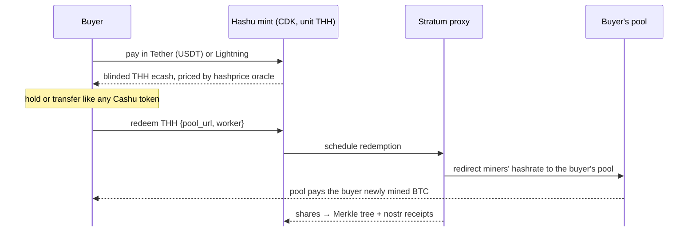

# Hashu

### An ecash mint that sells computation, not money

**The problem**

- A Cashu mint holds bitcoin and issues IOUs redeemable for bitcoin
- Accepting value and paying it back out to someone else looks like **money transmission**
- So operators face licensing and KYC risk, or stay small and hidden

**Hashu's answer**

- Hashu tokens (**THH**) are backed **only by miners' hashrate**, not by bitcoin
- **1 THH = 1 TH/s × 3,600 s** of hashing pointed where the holder chooses
- Redeeming a token returns **work**, never coins
- Running a Hashu mint means **selling computation**, not custodying or sending bitcoin

hashu.io · built on CDK · Rust · MIT / Apache-2.0

<!--
Framing: most Cashu mints custody BTC and pay it out on request, which is the
shape regulators call money transmission. Hashu changes what backs the token.
A THH token is a claim on hashing work from the operator's miners. The operator
never holds or sends the holder's bitcoin; it sells time on its machines, like
a cloud provider sells CPU-hours.
(This is our positioning, not a legal opinion.)
-->

---

# Dollars → hashrate → bitcoin, no exchange

**In: dollars** · pay with USDT; price locks in today's hashprice:
`N · hashprice · 1h + fee`

**Middle: computation** · THH is a bearer claim on hashing work, private by Cashu's blind signatures

**Out: bitcoin** · the buyer's own pool pays them for the work; the mint never sends BTC

<!--
The on-ramp without an exchange: USD stablecoin in, hashrate out, and the
bitcoin comes from mining, paid by the buyer's chosen pool. Hashu never
custodies or transmits the mined sats; it only routes Stratum traffic.
Each accepted share is committed to a per-connection RFC 6962 Merkle tree and
receipted on nostr, so the buyer can check the work against their pool.
-->

---

# Prototype on Testnet4

**Working today**

- ✅ Stratum V1 pass-through proxy + share counter
- ✅ Share commitment tree (RFC 6962) per connection
- ✅ Hashprice oracle: Esplora (free) + Luxor
- ✅ Operator manifest on nostr (append-only keysets)
- ✅ `hashu` CLI: init · config · manifest · oracle · proxy
- ✅ 99 tests + loopback miner ⇄ proxy ⇄ pool e2e

**Next**

1. 🚧 `hashrate` melt method + redemption ledger (CDK custom backend, on a branch)
2. Mint daemon + THH issuance on **Testnet4**, paid in **Tether** or **Lightning**
3. Proxy → ledger crediting and on-demand hashrate redirection
4. Per-share nostr receipts + completion certificate
5. Later: concurrent redemptions, buyer wallet, Stratum V2

**Demo today:** `hashu proxy run --upstream stratum+tcp://<testnet4-pool>:3333` · shares committed to the Merkle tree live 
**Target demo:** pay USDT → mint THH → redeem → watch shares (and Testnet4 coins) land at the buyer's pool

<!--
Be honest about status: proxy and attestation plumbing are built; issuance,
melt and payment backends are the next milestone. Trust model: this is a custodial
Chaumian mint with extra plumbing, mitigated by nostr-signed share receipts the
redeemer can check against their pool.
-->
