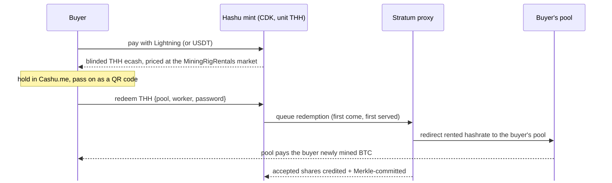

# Hashu

### An ecash mint that sells computation, not money

<div class="mt-6 grid grid-cols-2 gap-10 text-left text-sm">
<div>

**The problem**

- A Cashu mint holds bitcoin and issues IOUs redeemable for bitcoin
- Accepting value and paying it back out to someone else looks like **money transmission**
- So operators face licensing and KYC risk, or stay small and hidden

</div>
<div>

**Hashu's answer**

- Hashu tokens (**THH**) are backed **only by miners' hashrate**, not by bitcoin
- **1 THH = 1 TH/s × 3,600 s** of hashing pointed where the holder chooses
- Redeeming a token returns **work**, never coins
- Running a Hashu mint means **selling computation**, not custodying or sending bitcoin
- **Hashrate at Home:** a home heater can sell its hashrate as THH (Tether MDK)

</div>
</div>

<div class="abs-bl m-6 text-sm opacity-60">hashu.io · built on CDK · Rust · MIT / Apache-2.0</div>

<!--
Framing: most Cashu mints custody BTC and pay it out on request, which is the
shape regulators call money transmission. Hashu changes what backs the token.
A THH token is a claim on hashing work from the operator's miners. The operator
never holds or sends the holder's bitcoin; it sells time on its machines, like
a cloud provider sells CPU-hours.
(This is our positioning, not a legal opinion.)
-->

---

# Pay → hashrate → bitcoin, no exchange



<div class="grid grid-cols-3 gap-6 text-xs mt-1">
<div>

**In: sats or dollars** · mainnet Lightning via phoenixd, tested live. The USDT rail is built but not yet tested live

</div>
<div>

**Middle: computation** · THH is a bearer Cashu token for hashing work, private by blind signatures. Sales are capped at rented capacity

</div>
<div>

**Out: bitcoin** · the buyer's own pool pays them for the work; the mint never sends BTC

</div>
</div>

<!--
The on-ramp without an exchange: USD stablecoin in, hashrate out, and the
bitcoin comes from mining, paid by the buyer's chosen pool. Hashu never
custodies or transmits the mined sats; it only routes Stratum traffic.
Live: Lightning buys on mainnet (small buys held as phoenixd fee credit; the
mint absorbs the LSP fee). USDT code exists but has not been run live.
Each accepted share is credited to the redemption and committed to a
per-redemption RFC 6962 Merkle tree (signed nostr receipts are roadmap).
-->

---

# Share accounting: how work is counted

<div class="grid grid-cols-2 gap-8 text-sm mt-2">
<div>

**Exact integer math, in hashes**

```text
1 THH    = 1 TH/s × 3,600 s = 3.6 × 10¹⁵ hashes
1 share  = difficulty × 2³² hashes
melt N   → target = N × 3.6 × 10¹⁵ hashes
```

<div class="text-xs opacity-80 mt-1">

At difficulty 65,536, 1 THH ≈ 12.8 shares. A 40 TH/s heater fills 1 THH in 90 s.

</div>

**What counts**

- Only shares the **redeemer's pool accepts**; rejects earn nothing
- Shares sent to the operator's default pool earn nothing
- The redemption is fixed when `mining.submit` goes out, so a late ack after a pool switch still credits the right holder
- Shares in flight after the target is hit are ignored

</div>
<div>

**Lifecycle of one redemption**

<div class="flex items-center gap-2 text-xs my-3 flex-wrap">
<span class="px-2 py-1 rounded bg-gray-500/15">melt <code>hashrate</code></span>→
<span class="px-2 py-1 rounded bg-gray-500/15">Pending</span>→
<span class="px-2 py-1 rounded bg-blue-500/15">Active: + diff × 2³² per share</span>→
<span class="px-2 py-1 rounded bg-green-500/15">Completed: hashes ≥ target</span>
</div>

Completion is broadcast once: the router sends hashrate back to the default pool and the melt quote flips to **PAID**.


**Proof of work routed**

- Each accepted share is rebuilt into its 80-byte block header and appended to a per-redemption **RFC 6962 Merkle tree**
- The audit API serves the root and an inclusion proof per share: `/redemptions/{id}/root`, `/proof/{n}`
- Redemptions persist across restarts (journaled ledger + share trees)
- Roadmap: publish roots as signed nostr receipts

</div>
</div>

<!--
The ledger never uses floating-point THH: progress is an integer count of
expected hashes, so "done" is decided without rounding drift.
Credit = difficulty × 2^32 per share the redeemer's pool accepted (#7).
The routing controller tells the proxy which redemption a connection serves (#9);
that binding is sampled at submit time, so acks that arrive after a switch still
credit the right redemption. When the total crosses the target, the crediter
broadcasts completion once: the router moves hashrate back to the default pool and
the mint's hashrate melt quote flips to PAID (#13; the redemption id is derived
from the melt request, so cdk can look it up and nobody pays twice).
-->

---

# Hashrate at Home, on Tether MDK

<div class="grid grid-cols-[1.05fr_1fr] gap-6 text-sm mt-1">
<div>

**A home heater that sells its hashrate as THH**

1. Someone redeems THH; the proxy opens a redemption
2. The **Hashu Heater app** sees it on the proxy's control API and sends `setupPools` through the MDK Kernel: home pool → Hashu proxy
3. Shares go to the redeemer's pool and are credited
4. Filled → `setupPools` back to the home pool

<div class="text-xs mt-3 leading-snug">

- **Heater Worker** speaks the Bitaxe AxeOS API: hashrate, power, temperature, pool, heat level (`setPowerMode`)
- **Thermostat** with a hard ceiling: pauses even mid-redemption, then resumes
- **Fail-safe:** proxy unreachable → heater goes back home
- Heatbit firmware is closed, so it stays pointed at the proxy

</div>
</div>
<div>


<div class="text-xs mt-2 leading-snug">

**~62 sats per kWh of heat** at demo pricing (32.4 J/TH), against 0 for an electric heater with the same output.

Demo with no hardware: `cd mdk && ./scripts/demo.sh`

</div>
</div>
</div>

<!--
Built for the bitcoin++ Seoul Hashrate at Home award, which requires Tether's MDK (#12).
Every watt a miner draws ends up as heat, just like an electric heater; this one also
earns by selling THH. The mock heater is 40 TH/s, 1300 W and really mines over Stratum,
so a 1 THH redemption fills through the proxy in about 90 s with no hardware.
The app's policy is pure and unit tested: redemption open → Hashu proxy, otherwise home;
thermostat with hysteresis plus a ceiling; manual override per heater.
-->

---

# What works today

<div class="grid grid-cols-2 gap-8 text-sm mt-2">
<div>

**Live on mainnet at mint.hashu.io**

- ✅ CDK mint, unit **THH**, works in the **Cashu.me** wallet
- ✅ Buy with **mainnet Lightning** (phoenixd), tested end to end; the mint absorbs LSP fees on small buys
- ✅ Tokens move as QR codes, animated for long tokens
- ✅ Redeem to **any pool + worker**, optional worker password. Redeeming live to our Braiins account now
- ✅ Hashrate from **MiningRigRentals**: 413 TH/s, 70/70 shares accepted at Braiins
- ✅ Sales capped at rented capacity; redemptions first come, first served
- ✅ Redemptions survive restarts; per-redemption Merkle root + inclusion proofs
- ✅ Operator page: hashrate graphs, test mint, redeem. Checkout shows delivery time

</div>
<div>

**Hashrate at Home**

- ✅ Hashu Heater app on Tether MDK switches the heater's pool on redeem and back when filled (mock 40 TH/s heater mines for real)

**Built, not yet proven live**

- 🧪 USDT rail (Sepolia test USDT)
- 🧪 A physical heater run (Bitaxe / Heatbit)

**Roadmap**

- 🔜 Nostr-signed Merkle roots and completion certificates
- 🔜 More hashrate sources than one rental market

</div>
</div>

<!--
Everything in the left column runs on the devbox behind mint.hashu.io right now.
The rigs are rented on MiningRigRentals and pointed at the Hashu proxy; when nobody
is redeeming they mine on Braiins. We moved the demo from Testnet4 to mainnet
because MRR's relay rejects Testnet4 jobs (future-stamped ntime).
Be explicit about the right column: USDT code exists and is unit tested but has not
taken a live payment; nostr attestation (attestation.rs) is not built.
-->

---

# Live demo

<div class="grid grid-cols-2 gap-10 text-sm mt-4">
<div>

**Try it**

- Buy THH: **[mint.hashu.io/checkout/](https://mint.hashu.io/checkout/)**
- Mint URL for Cashu.me: `https://mint.hashu.io`
- Code: **[github.com/asherp/hashu](https://github.com/asherp/hashu)** (Rust, MIT / Apache-2.0)
- These slides: hashu.io/slides

</div>
<div>

**What we'll show**

1. Pay a Lightning invoice, get a THH token as a QR
2. Scan it into Cashu.me
3. Redeem to a Braiins worker
4. Watch the rented hashrate move on the operator graph
5. Shares land at the pool; the redemption fills and hashrate goes home

</div>
</div>

<!--
Have the operator page open in a second tab. Keep the buy small so it fills during the talk;
checkout shows the delivery-time estimate before you pay.
-->
