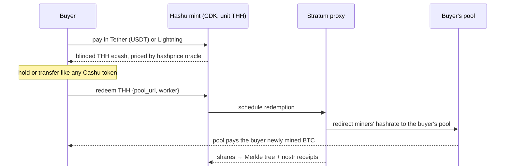

# Hashu

### An ecash mint that sells computation, not money

**The problem**

- A Cashu mint holds bitcoin and issues IOUs redeemable for bitcoin
- Accepting value and paying it back out to someone else looks like **money transmission**
- So operators face licensing and KYC risk, or stay small and hidden

**Hashu's answer**

- Hashu tokens (**THH**) are backed **only by miners' hashrate**, not by bitcoin
- **1 THH = 1 TH/s × 3,600 s** of hashing pointed where the holder chooses
- Redeeming a token returns **work**, never coins
- Running a Hashu mint means **selling computation**, not custodying or sending bitcoin
- **Hashrate at Home:** a home heater can sell its hashrate as THH (Tether MDK)

hashu.io · built on CDK · Rust · MIT / Apache-2.0

<!--
Framing: most Cashu mints custody BTC and pay it out on request, which is the
shape regulators call money transmission. Hashu changes what backs the token.
A THH token is a claim on hashing work from the operator's miners. The operator
never holds or sends the holder's bitcoin; it sells time on its machines, like
a cloud provider sells CPU-hours.
(This is our positioning, not a legal opinion.)
-->

---

# Dollars → hashrate → bitcoin, no exchange

**In: dollars** · pay with USDT; price locks in today's hashprice:
`N · hashprice · 1h + fee`

**Middle: computation** · THH is a bearer claim on hashing work, private by Cashu's blind signatures

**Out: bitcoin** · the buyer's own pool pays them for the work; the mint never sends BTC

<!--
The on-ramp without an exchange: USD stablecoin in, hashrate out, and the
bitcoin comes from mining, paid by the buyer's chosen pool. Hashu never
custodies or transmits the mined sats; it only routes Stratum traffic.
Each accepted share is committed to a per-connection RFC 6962 Merkle tree and
receipted on nostr, so the buyer can check the work against their pool.
-->

---

# From scaffold to demo, in one day

**This morning**

- Stratum V1 proxy + share Merkle tree
- Hashprice oracles (Esplora, Luxor)
- Nostr operator manifest, `hashu` CLI
- ❌ No minting, no payments
- ❌ No Testnet4, no Tether
- ❌ No redemption or redirection

**What we tackled** (tracking issue #3)

- ✅ #2 &nbsp;`hashrate` melt method + redemption ledger (CDK)
- ✅ #4 &nbsp;Dropped the Lightning melt: a Hashu mint never pays out BTC
- ✅ #5 &nbsp;Testnet4 + MiningRigRentals hashprice oracle
- ✅ #6 &nbsp;Lightning rail: buy THH with bolt11
- ✅ #8 &nbsp;Tether rail: buy THH with USDT
- ✅ #7 &nbsp;Proxy credits shares to the redemption
- ✅ #9 &nbsp;Redirect hashrate to the redeemer's pool
- ✅ #12 &nbsp;Hashu Heater on Tether MDK (Bitaxe Worker)
- 🚧 #11 &nbsp;Mainnet Lightning via phoenixd
- 🚧 #13 &nbsp;`hashu mint run`: mint + rails + proxy, one process

**The demo**

1. Pay USDT or Lightning
2. Mint THH, blind-signed
3. Melt `hashrate` to your pool
4. MDK app moves the heater to the Hashu proxy
5. Shares land on the Testnet4 pool; heater goes home when filled

<!--
Walk the arc: this morning the repo was plumbing only (proxy, oracles, manifest).
Every row in the middle is a merged or in-review PR toward the demo milestone (#3).
#4 matters for the pitch: we removed the cash-out path so the mint only ever
receives payment and delivers work, which is the "selling computation" argument.
#12 is the Hashrate at Home angle: a home heater sells its hashrate as THH, and the
MDK app switches it to the redeemer's pool only while a redemption is open.
Still open: phoenixd mainnet (#11), the one-process daemon (#13), a real Bitaxe run.
-->
